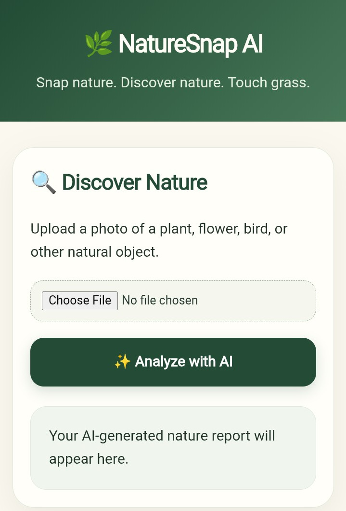
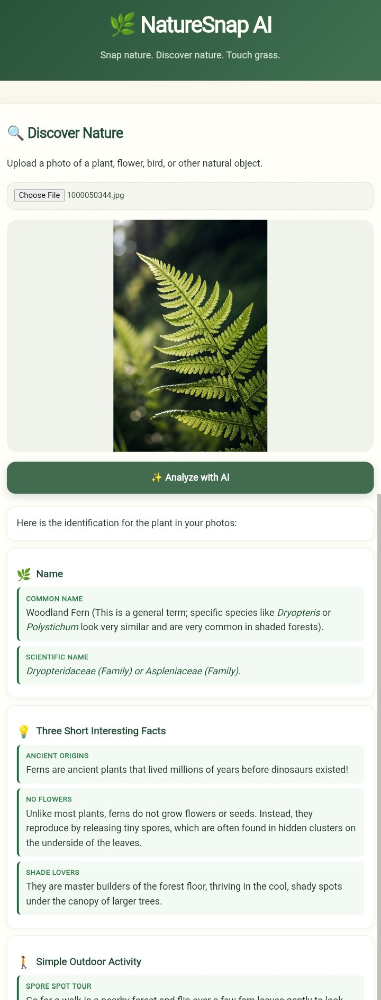
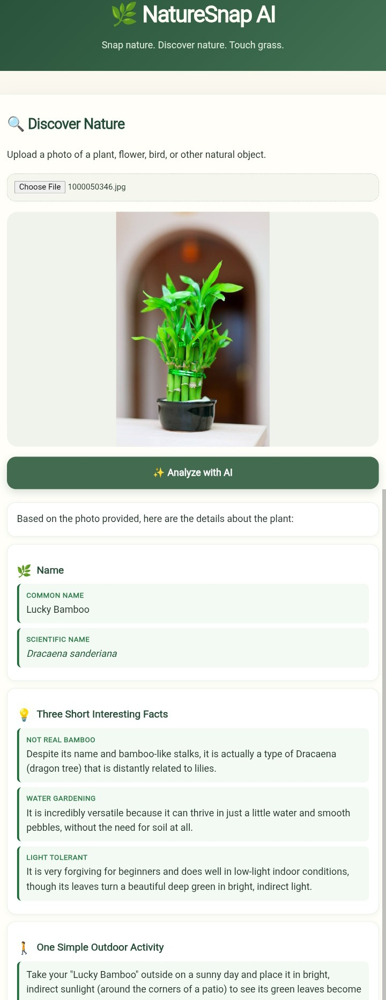

# NatureSnap AI

[](LICENSE)
[](https://nodejs.org/)
[](https://expressjs.com/)
[](https://groq.com/)
[](https://naturesnap-ai.onrender.com/)

Upload a nature photo and get a short, AI-generated report with an identification, facts, and an outdoor activity.

## Features

- **Image upload:** Upload a plant, flower, bird, animal, or other natural object.
- **AI-powered analysis:** Send the image to the Groq API for a generated report.
- **Nature insights:** See a possible common or scientific name and three short facts.
- **Outdoor activity:** Get one simple activity related to the subject.
- **Session history:** Review nature analyses created during your current session.
- **Saved discoveries:** Save favorite findings to a permanent personal collection, complete with image thumbnails and full reports.
- **Responsive interface:** Use the sage-green web interface on desktop or mobile.

## Tech Stack

- **Frontend:** HTML, CSS, and browser JavaScript
- **Backend:** Node.js and Express
- **AI integration:** Groq chat completions API with `qwen/qwen3.8-27b`
- **Uploads:** Multer memory storage
- **Deployment:** Render

## Live Demo

[Open NatureSnap AI](https://naturesnap-ai.onrender.com/)

The free Render instance may take **30–60 seconds** to wake up on the first visit.

## Screenshots

Actual screenshots are available in `docs/screenshots/`.

### Home



### Result




## Getting Started

### Prerequisites

- Node.js and npm
- A Groq API key
- Git

### Installation

```bash
git clone https://github.com/05unique-dotcom/NatureSnap-AI.git
cd NatureSnap-AI
npm install
```

Create `.env` in the project root:

```env
GROQ_API_KEY=your_key
```

Never commit `.env` or expose the API key publicly.

Start the application:

```bash
npm start
```

Open [http://localhost:3000](http://localhost:3000).

### Running Tests

Execute the automated test suite covering discovery storage, API endpoints, error handling, and security:

```bash
npm test
```

Check server syntax:

```bash
node --check server.js
```

## How to Use

1. Select a photograph.
2. Preview the image.
3. Click **Analyze with AI**.
4. Read the generated nature report.

AI-generated identifications are suggestions and may not always be accurate. Verify important botanical information with reliable sources.

## How It Works

1. The browser uploads an image to the Express backend.
2. The backend checks that an image is present and within the upload limit.
3. The backend converts the image to a data URL and sends it to the Groq vision-capable model.
4. The response is returned as a short analysis and formatted in the browser.

## API / Endpoints

### `GET /`

Serves the NatureSnap AI web interface.

### `POST /api/analyze`

Accepts a multipart form upload using the field name `image`. Returns JSON in the form:

```json
{
  "analysis": "AI-generated nature report"
}
```

The endpoint returns an error message if no image is supplied, the upload is too large, the API key is unavailable, or the upstream analysis fails.

## Security

- Store API keys in environment variables.
- Keep `.env` excluded from version control using `.gitignore`.
- Never expose private credentials in frontend JavaScript or public repositories.
- Backend upload validation and size limits help reduce unsafe or excessive uploads.

## Project Goals

NatureSnap AI aims to make learning about nature interactive, accessible, and enjoyable through AI-assisted discovery.

## Image History & Saved Discoveries

NatureSnap AI allows you to track and save your nature observations directly in the browser:

### 1. Session History
- Every completed analysis is automatically recorded in your session history.
- The **History** tab displays previously analyzed subjects with thumbnails, extracted names, summary snippets, and analysis timestamps.
- Click **View Details** on any history item to inspect the full AI report.
- Clear session history at any time using the **Clear** button.

### 2. Saved Discoveries
- Click **Save Discovery** on any active analysis or history card to preserve it in your personal collection.
- Saved discoveries persist locally across browser sessions and reloads using `localStorage`.
- The **Saved** tab lists all saved discoveries with image references, dates, and summaries.
- Click **Remove** to delete an entry from your saved collection.
- Accidental duplicate saves are automatically detected and prevented.

### Data Storage Architecture & Format
Saved entries preserve both the image reference and the complete generated report in a structured format:

```json
{
  "id": "nat_1731000000000_abc123",
  "title": "Monarch Butterfly (Danaus plexippus)",
  "summary": "A large, migratory butterfly famous for its vibrant orange and black wings...",
  "report": "### 1) Name: Monarch Butterfly...",
  "imageReference": "data:image/jpeg;base64,...",
  "createdAt": "2026-11-07T18:15:00.000Z",
  "savedAt": "2026-11-07T18:15:05.000Z"
}
```

Image references use lightweight client-side thumbnails (~5–8 KB) to prevent excessive storage consumption while preserving visual identity. If an image reference is unavailable, missing, or corrupted, a botanical leaf placeholder is displayed gracefully without broken UI elements.

## Future Improvements

Potential enhancements include:

- More structured plant identification reports
- Improved scientific-name formatting
- Export and import for saved nature discoveries
- Additional information about plant care and habitats
- Accessibility and performance improvements
- Support for more categories of natural objects

## Project Structure

```text
.
├── .env.example             # Environment variable template
├── index.html               # Frontend interface and browser logic
├── discovery-store.js       # Session history and saved discoveries store
├── server.js                # Express server and Groq API integration
├── test/                    # Automated test suite (unit, integration, security)
│   ├── discovery-store.test.js
│   └── server.test.js
├── package.json             # Project metadata, scripts, and dependencies
├── docs/screenshots/        # Location for real project screenshots
├── .github/                 # Issue, pull request, and CI configuration
├── CONTRIBUTING.md          # Contribution and pull request guidance
├── CODE_OF_CONDUCT.md       # Community conduct expectations
├── SECURITY.md              # Private vulnerability reporting guidance
└── LICENSE                  # MIT License
```

## Contributing

Suggestions, bug reports, and contributions are welcome. See [CONTRIBUTING.md](CONTRIBUTING.md) for setup and pull request guidance.

## License

Licensed under the MIT License. See [LICENSE](LICENSE).

## Repository

[05unique-dotcom/NatureSnap-AI](https://github.com/05unique-dotcom/NatureSnap-AI)

Built with curiosity, AI, and a love for nature.
